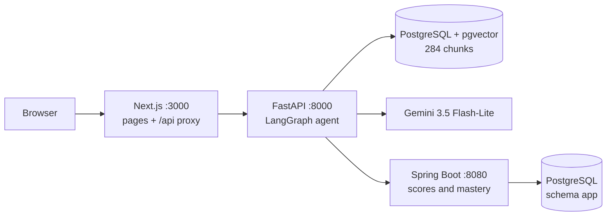

# StudyMate

[](https://github.com/badrlaaji/studymate/actions/workflows/ci.yml)

A study assistant for one textbook — *Principles of Data Science* (OpenStax), chapters 6
(machine learning) and 7 (deep learning and AI). It answers questions in **English or
French** with **page citations checked by code**, opens the cited page with the passage
highlighted, tests your understanding with a **Feynman mode**, and keeps a **mastery map**
that drives targeted quizzes and a revision plan.

> Demo video (2 min): coming soon.


## The problem

A general chatbot gives fluent answers about a course with no way to check them against the
textbook. A student needs answers grounded in *their* book, with pages they can open, and
honest feedback on what they have actually understood.

## What it does

- **Ask the book** (`/study`): a LangGraph agent retrieves passages, Gemini writes the answer,
  and the code accepts it only if every cited page was really retrieved; otherwise one retry,
  then "not found". The cited PDF page opens next to the chat with the passage highlighted.
- **Feynman mode** (`/feynman`): explain a notion in your own words; the LLM judges each key
  idea of the catalogue, and the **code** computes the 0-5 score.
- **Mastery map** (`/`): one tile per notion, coloured by the average of the last 3 scores,
  with a revision plan (weakest notions, pages to re-read) computed without any LLM.
- **Quiz** (`/quiz`): multiple-choice questions on the weakest notions (keys 1-4), graded by
  code, with the source page of each answer.
- **Bilingual**: French questions are rewritten into an English search query by the router (the
  book is in English); the interface switches between English and French.

## Architecture



- Offline: PDF → clean pages (`pypdf`, headers and footers removed) → chunks of at most 300
  tokens → `multilingual-e5-small` embeddings (fine-tuned) → pgvector.
- The browser only talks to Next.js; FastAPI is the only client of Spring. If Spring is down,
  the assistant still answers and scores are simply not recorded (degraded mode).

## Results

All numbers come from the scripts in `eval/` (reports in `eval/results/`).

**Retrieval** — 20 test questions, each asked in English and in French, written by paraphrasing
the book (not generated by the LLM). A hit is a retrieved chunk on an expected PDF page.

| Embeddings | Language | hit@4 | MRR@10 |
| --- | --- | --- | --- |
| e5-small (base) | English | 0.850 | 0.703 |
| e5-small (base) | French | 0.750 | 0.604 |
| e5-small fine-tuned | English | 0.950 | 0.722 |
| e5-small fine-tuned | French | 0.800 | 0.611 |

Fine-tuning: 560 synthetic question-passage pairs (English + French, generated by Gemini,
decontaminated against the evaluation questions), `MultipleNegativesRankingLoss`, 2 epochs on
CPU (7 min). hit@4 improves (+2 English, +1 French questions); MRR barely moves.

**Answers** — the full agent on the same 20 test questions and 5 out-of-course traps. *Correct* =
the answer passed the citation check **and** cites an expected page (no LLM judge).

| Language | Correct | Expected page in top 4 | Traps refused |
| --- | --- | --- | --- |
| English | 19/20 | 19/20 | 5/5 |
| French | 19/20 | 19/20 | 5/5 |

Rewriting French questions into English search queries (inside the router call, no extra LLM
call) raised French top-4 retrieval from 16/20 to 19/20.

**Answer quality** (RAGAS 0.4.3, 20 English test questions): faithfulness **0.934**, answer
relevancy **0.931**.

**Speed and front end** — median `/chat` latency **2.73 s** (p90 3.17 s) on 20 questions never
asked before (dev set, English and French), Gemini free tier, CPU only. Lighthouse 13.5
(production build):

| Page | Device | Performance | Accessibility | Best practices | SEO |
| --- | --- | --- | --- | --- | --- |
| `/study` | mobile | 98 | 100 | 100 | 100 |
| `/study` | desktop | 100 | 100 | 100 | 100 |
| `/` (map) | mobile | 99 | 100 | 100 | 100 |
| `/` (map) | desktop | 100 | 100 | 100 | 100 |

## Limits

- **Small evaluation sets** (20 test questions, 5 traps): differences of one or two questions
  are within noise; the fine-tuning gain is indicative only.
- **Same model as judge and generator** for RAGAS and the Feynman judge: scores may be
  optimistic. The Feynman judge is checked against blind human grades (protocol in
  `eval/eval_feynman.py`).
- **Formulas are lost**: they are drawn as vector graphics in the PDF, so they are absent from
  the extracted text (about 35 % of the pages are affected); the PDF panel still shows them.
- **A verified citation is not always the best page**: the check proves the page was retrieved
  and cited, not that it is the most relevant one (1 miss out of 20).
- **Free tier**: rate limits and occasional 503 errors from Gemini; the code waits and retries
  once. No public deployment (the free tier does not allow it for EU/UK users): local demo only.

## Run it

Windows, PowerShell, Python 3.13 with [uv](https://docs.astral.sh/uv/), Node 22, JDK 21:

```powershell
uv venv --python 3.13
uv pip install torch==2.14.1 --index-url https://download.pytorch.org/whl/cpu
uv pip install -r requirements.txt -r requirements-dev.txt
Copy-Item .env.example .env        # Gemini key, Neon connection strings
uv run python -m scripts.check_env all
uv run python -m scripts.download_book
uv run python -m rag.ingest        # pages -> chunks -> embeddings -> PostgreSQL
.\scripts\dev.ps1                  # API :8000, Spring :8080, web :3000
```

With Docker: `docker compose -f infra/docker-compose.yml up --build` (PostgreSQL + pgvector,
API, Spring, web), then index once with
`docker compose -f infra/docker-compose.yml run --rm --user root api python -m rag.ingest`
(one-off job as root: the mounted `data/` folder may not be writable by the API's non-root
user). Until the book is indexed, `/chat` answers 503 with that command. The image embeds the
base e5 model; pass `--build-arg EMBEDDING_MODEL=<Hub id>` to use the fine-tuned one.

Tests: `uv run pytest -q` (no network), `cd core; .\mvnw.cmd test`, `cd frontend; npm run build`.


## Stack

Python 3.13 (FastAPI, LangGraph, LangChain, sentence-transformers, PyTorch CPU, pypdf, asyncpg),
Gemini `gemini-3.5-flash-lite` with Pydantic structured outputs, PostgreSQL + pgvector (Neon in
development), Next.js 16 + React 19 + react-pdf + Recharts, Spring Boot 4.1 + Java 21, GitHub
Actions, Docker Compose. Design decisions are logged in [DECISIONS.md](DECISIONS.md) and the
measured progress in [JOURNAL.md](JOURNAL.md).

## Attribution

Course content: *Principles of Data Science* by Shaun V. Ault, Soohyun Nam Liao and Larry
Musolino (senior contributing authors), OpenStax, Rice University, 2025, licensed under
[CC BY-NC-SA 4.0](https://creativecommons.org/licenses/by-nc-sa/4.0/). Access for free at
[openstax.org](https://openstax.org/details/books/principles-data-science). The book PDF is
downloaded locally and never stored in this repository.

## License

Code: [MIT](LICENSE). Files derived from the book (`course/notions.json`, `eval/*.json`):
CC BY-NC-SA 4.0, see [LICENSE-CONTENT.md](LICENSE-CONTENT.md).
