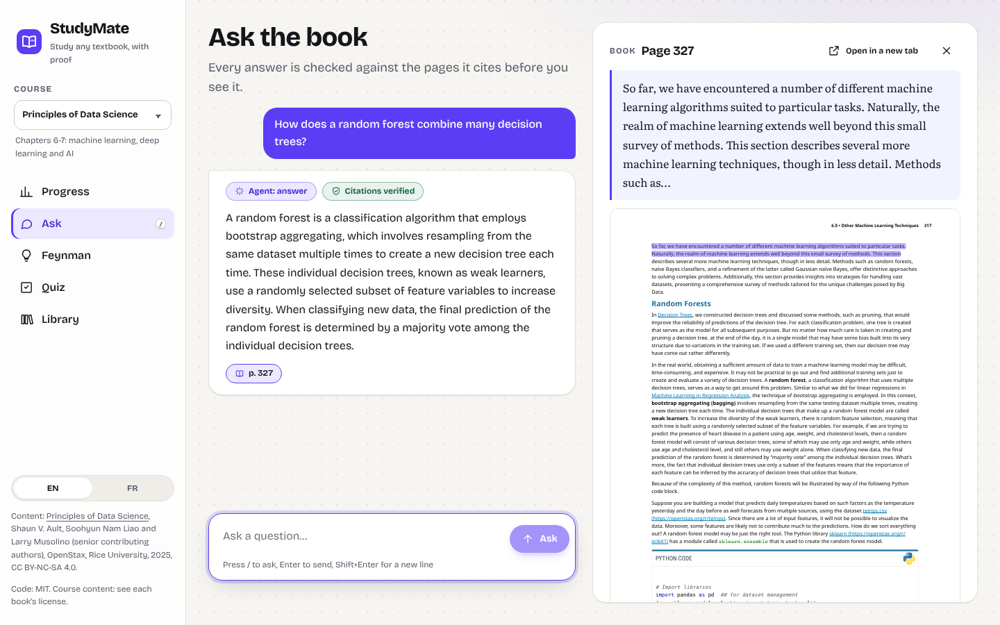
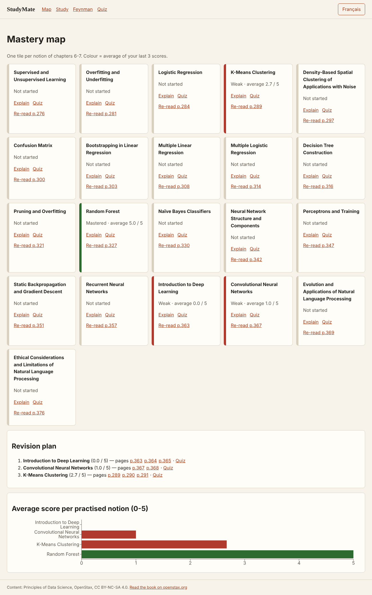
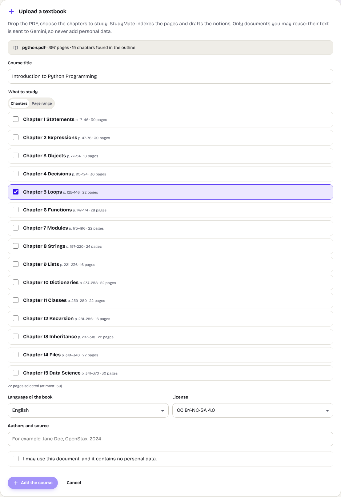
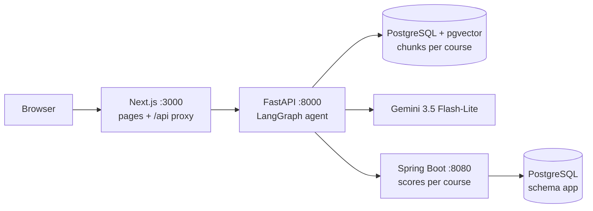
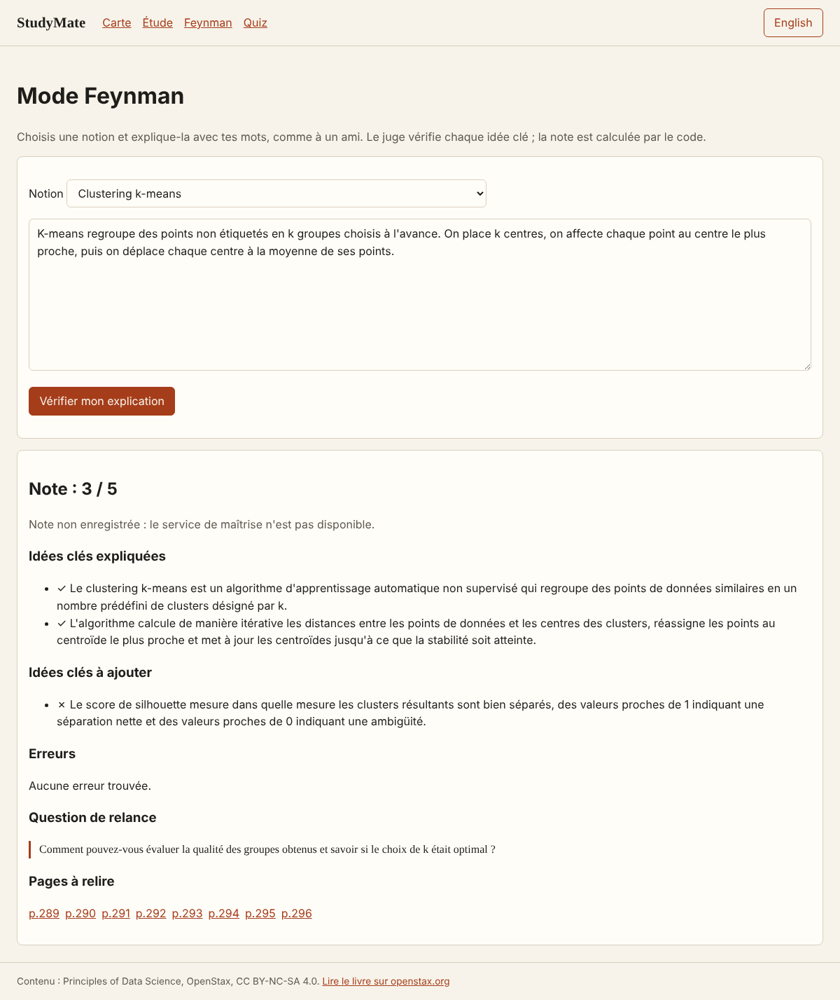
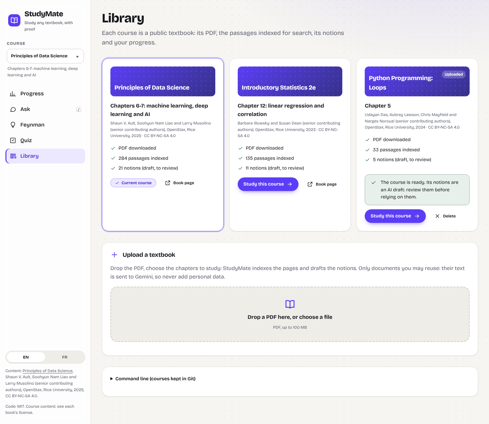
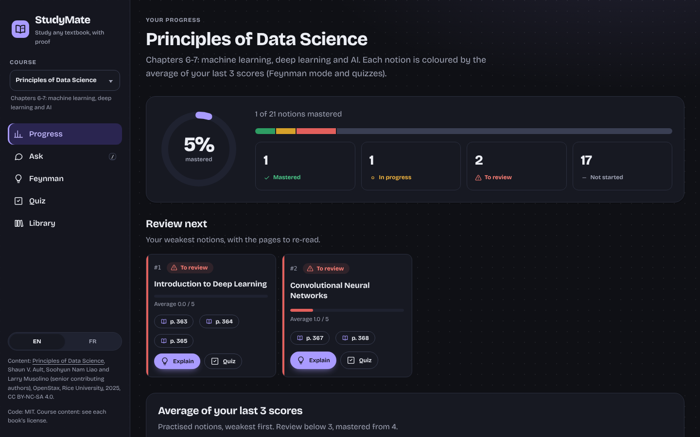
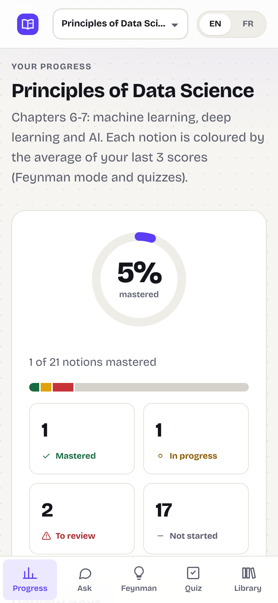

# StudyMate

[](https://github.com/badrlaaji/studymate/actions/workflows/ci.yml)

A study assistant for **open textbooks**. Ask a question in **English or French**: the answer
cites the book's pages, the **code checks every citation**, and the cited page opens next to
the chat with the passage highlighted. Then explain a notion in your own words (**Feynman
mode**), take a **quiz** on your weak spots, and follow your **progress** notion by notion.

It ships with two courses — *Principles of Data Science* (chapters 6-7, machine learning and
deep learning; the fully evaluated reference course) and *Introductory Statistics 2e*
(chapter 12, regression and correlation) — and **a new course is added with one command**.

> Demo video (2 min): coming soon. A **public demo without any AI call** can be hosted from
> this repository: see [Public demo](#public-demo-no-ai-call).



## The problem

A general chatbot gives fluent answers about a course with no way to check them against the
textbook. A student needs answers grounded in *their* book, with pages they can open, and
honest feedback on what they have actually understood.

## What it does

- **Ask the book** (`/study`): a LangGraph agent routes the message (answer, quiz or revision
  plan), retrieves passages, Gemini writes the answer, and the code accepts it only if every
  cited page was really retrieved; otherwise one retry, then "not in this course".
- **Feynman mode** (`/feynman`): explain a notion; the LLM judges each key idea of the
  catalogue, and the **code** computes the 0-5 score.
- **Progress** (`/`): mastery of every notion (average of the last 3 scores), what to review
  next with the pages to re-read, and a **review date per notion** from spaced repetition
  (FSRS, replayed from the dated scores), all computed without any LLM.
- **Quiz** (`/quiz`): multiple-choice questions on the notions due for review first, then the
  weakest ones (keys 1-4, Enter), graded by code, with the source page of each answer. A
  skipped question (key P, Skip button or a fist) is not graded: it changes neither the
  mastery nor the review date, and the summary lists it with the pages to re-read.
- **Answer with your hand** (`/quiz`, camera off by default): MediaPipe Hand Landmarker runs
  in the browser; 1 to 4 raised fingers answer 1 to 4, a fist held 1.5 s skips, an open hand
  goes on. A gesture must stay the same for 1 s (progress ring, spoken by screen readers);
  removing the hand or Escape cancels. No image is sent or stored.
- **Study sessions, goal and trophies**: an *estimated study time* counted while you study
  and paused when the tab is hidden, when you press Pause, or (optional camera, off by
  default) when no face has been in front of the screen for 5 s. MediaPipe Face Detector
  checks once a second whether a face is there: no face recognition, no emotion, no image
  sent or stored; the browser only sends `{session, active seconds}`, and Spring refuses more
  time than really passed. Daily goal (5-480 minutes, in your time zone), streak, last 7 days,
  and 6 trophies computed by Spring (first steps, goal reached, regular, perfect week,
  marathon, flawless quiz).
- **Accounts** (`/login`): sign up and sign in; scores, review dates and quiz logs belong to
  each user. Spring Boot hashes passwords (BCrypt) and signs a JWT (HS256, 7 days); the token
  stays in an HttpOnly cookie, Next.js relays it to FastAPI, which relays it to Spring. No
  token: 401; another user's data: 403. Without an account, answers still work, nothing is
  saved.
- **Library** (`/library`): one card per course (PDF, indexed passages, notions); **upload
  a textbook PDF** and choose its chapters; switch course from the sidebar. Each course has
  its own index, notions and scores.
- **Bilingual**: French questions are rewritten into a search query in the book's language;
  the interface switches between English and French. Light and dark themes.



## Public demo (no AI call)

The web app has a read-only **demo mode** (`DEMO_MODE=1`) meant for public hosting:

- The answers to a few example questions, three quizzes per language and the Feynman grades of
  example explanations were computed **once** by the real pipeline
  (`uv run python -m scripts.build_demo`) and saved in `frontend/demo/data.json`.
- Next.js answers every `/api/*` route itself: no FastAPI, no database, **no Gemini call and no
  key**. A Vitest test traps `fetch` and every socket: it fails if a demo route opens any
  outgoing connection.
- Feynman and quiz scores stay in a cookie of the visitor's browser; the progress map and the
  revision plan use the same rules as Spring (average of the last 3 scores).
- Any other question gets "example questions only"; a cited page opens on openstax.org.

Run it locally (PowerShell): `cd frontend; npm ci; npm run build; $env:DEMO_MODE="1"; npm run start`,
or with Docker: `docker build -t studymate-web frontend` then
`docker run -e DEMO_MODE=1 -p 3000:3000 studymate-web`.

Host it, for example on Vercel (Hobby plan, personal non-commercial use): import the GitHub
repository, set the root directory to `frontend`, add the environment variable `DEMO_MODE=1`,
deploy. Nothing else is needed: no secret, no database. Live link: [X] (not deployed yet).

## Add your own course

Any textbook you are allowed to reuse works (for example an [OpenStax](https://openstax.org)
book). Its text is sent to Gemini to draft the notions, so never add private documents.

**From the interface** (`/library` → *Upload a textbook*): drop the PDF (up to 100 MB),
pick chapters found in its outline or a page range (at most 150 pages), give the license and
the authors, and confirm you may use the document. The API indexes the pages, then drafts
the notions in the background; the card shows each step, a *Retry* button if Gemini's free
quota runs out, and *Delete*. Uploaded courses stay in `data/` (never in Git).



Measured with *Introduction to Python Programming* (OpenStax, 397 pages, 15 chapters found):
chapter 5 gave 22 pages, 33 indexed passages and 5 notions; the question "What is the
difference between a for loop and a while loop?" was answered with verified citations
(pages 125 and 143).

**From the command line** (courses kept in Git): describe the course in
[`course/courses.json`](course/courses.json) (id, title, PDF link, license, chapters or a
page range), then run `uv run python -m course.add <id>`; review `course/notions/<id>.json`
and set `"validated": true`.

Measured for *Introductory Statistics 2e*, chapter 12: 61 pages, 135 indexed passages and
11 drafted notions in 3 minutes (CPU, Gemini free tier). The same question about random
forests finds page 327 in the data science course and is refused in the statistics course.

## Architecture



- Offline, per course: PDF → clean pages (`pypdf`, headers and footers removed) → chunks of
  at most 300 tokens → `multilingual-e5-small` embeddings (fine-tuned) → pgvector, tagged
  with the course id.
- The browser only talks to Next.js; FastAPI is the only client of Spring. If Spring is down,
  the assistant still answers and scores are simply not recorded (degraded mode).

## Results

All numbers come from the scripts in `eval/` (reports in `eval/results/`), on the reference
course *Principles of Data Science*.

**Retrieval** — 20 test questions, each asked in English and in French, written by paraphrasing
the book (not generated by the LLM). A hit is a retrieved chunk on an expected PDF page.

| Embeddings | Language | hit@4 | MRR@10 |
| --- | --- | --- | --- |
| e5-small (base) | English | 0.850 | 0.703 |
| e5-small (base) | French | 0.750 | 0.604 |
| e5-small fine-tuned | English | 0.950 | 0.722 |
| e5-small fine-tuned | French | 0.800 | 0.611 |

Fine-tuning: 560 synthetic question-passage pairs (English + French, generated by Gemini,
decontaminated against the evaluation questions), `MultipleNegativesRankingLoss`, 2 epochs on
CPU (7 min). hit@4 improves (+2 English, +1 French questions); MRR barely moves.

**Answers** — the full agent on the same 20 test questions and 5 out-of-course traps. *Correct* =
the answer passed the citation check **and** cites an expected page (no LLM judge).

| Language | Correct | Expected page in top 4 | Traps refused |
| --- | --- | --- | --- |
| English | 18/20 (19/20 before the multi-course prompts) | 18/20 | 5/5 |
| French | 19/20 | 19/20 | 5/5 |

French questions are rewritten into English search queries inside the router call (no extra
LLM call): French top-4 retrieval went from 16/20 to 19/20. The English miss (test02) came
from the same rewrite applied to an English question, which dropped words; questions in the
book's language are now searched verbatim, and test02 then cites the expected page (checked
on that question; a full re-run is pending because the free-tier quota was exhausted).

**Answer quality** (RAGAS 0.4.3, 20 English test questions, before the multi-course prompts):
faithfulness **0.934**, answer relevancy **0.931**.

**Regression gate (CI)** — on every push, the `eval` job indexes the book with the base e5
model, measures retrieval for real, and replays the agent on the 20 test questions and 5 traps
in both languages **without calling Gemini**: the LLM answers come from `eval/replay/` (112
answers recorded by `uv run python -m eval.regression record`). A prompt that changed has no
recording and counts as a wrong answer, so any change to what the LLM sees must be re-recorded
and pass again. Minimums in `eval/thresholds.json`: one question of margin, none on the traps.

| Base e5 | English | French | Minimum (EN / FR) |
| --- | --- | --- | --- |
| hit@4 | 0.85 | 0.75 | 0.80 / 0.70 |
| MRR@10 | 0.703 | 0.604 | 0.65 / 0.55 |
| Correct answers | 16/20 | 18/20 | 15 / 17 |
| Traps refused | 5/5 | 5/5 | 5 / 5 |

Deliberate regression: making the English-only `all-MiniLM-L6-v2` the default embedding model
passes every unit test but fails the gate: French hit@4 drops from 0.75 to 0.60, while
English MRR even rises (0.703 → 0.793). Only the bilingual evaluation sees it. In GitHub
Actions: [the failing run](https://github.com/badrlaaji/StudyMate/actions/runs/40222183740)
(unit tests green, `eval` red) and
[the same commit without it](https://github.com/badrlaaji/StudyMate/actions/runs/40222173735)
(the CI runner reproduces the local numbers, 0 missing recordings).

**Speed** — median `/chat` latency **2.74 s** (p90 3.43 s) on 20 questions sent with an empty LLM cache (dev set, English and French), Gemini free tier, CPU only, measured again on 25 October 2026 (2.73 s at step 10). When the free-tier quota is saturated, the code waits 60 s and retries: see the burst row below.

**LLM tracing** (MLflow 3.17, local server) — every request is a trace and every Gemini call
a span with its latency, input and output tokens, cache hit and 429/5xx errors. The 10 dev
questions in English and French through the real API, with an empty LLM cache (so every call
reaches Gemini), measured on 25 October 2026 (`eval/results/llm_traces*.json`):

| Pace | Live LLM calls | Calls with a 429 | Requests with a 429 | LLM call median / p90 | `/chat` median / max |
| --- | --- | --- | --- | --- | --- |
| 6 s between questions | 40 | 0.0 % | 0.0 % | 1.22 s / 1.42 s | 2.74 s / 3.50 s |
| no pause (burst) | 40 | 7.5 % | 15.0 % | 1.32 s / 1.72 s | 2.62 s / 60.91 s |

A request costs about 1,300 input tokens (router + answer, two calls). A 429 costs a 60 s
wait before the single retry: the pause in the scripts avoids it. Run it: start
`uv run mlflow server --backend-store-uri sqlite:///data/mlflow.db --artifacts-destination data/mlflow-artifacts --port 5000`, set
`MLFLOW_TRACKING_URI=http://127.0.0.1:5000`, use the app, then
`uv run python -m eval.llm_traces` (or open the MLflow UI). Without the variable, tracing
is off and costs nothing. MLflow's own usage statistics are switched off.

**Front end** — Lighthouse 13.5 on the production build, and axe-core (WCAG 2.2 AA rules):
**0 violations** on the 6 pages × light/dark × desktop/mobile, and on the answered, Feynman
and quiz states.

| Page | Mobile: perf. / a11y / best pr. / SEO | Desktop |
| --- | --- | --- |
| `/` progress | 94 / 100 / 100 / 100 | 100 / 100 / 100 / 100 |
| `/study` | 97 / 100 / 100 / 100 | 100 / 100 / 100 / 100 |
| `/feynman` | 97 / 100 / 100 / 100 | 100 / 100 / 100 / 100 |
| `/quiz` | 100 / 100 / 100 / 100 | 100 / 100 / 100 / 100 |
| `/library` | 97 / 100 / 100 / 100 | 100 / 100 / 100 / 100 |

## Interface

A dot-grid notebook with one violet "highlighter" accent. Local fonts only (Bricolage
Grotesque for the interface, Literata for the book's text, both SIL OFL), inline SVG icons,
CSS tokens for light and dark themes. Mastery levels always pair colour with an icon and a
label; their colours were checked with a palette validator for colour-blind separation and
contrast. The progress chart uses one hue with threshold lines at 3 (review) and 4 (mastered).





| Dark theme | Phone |
| --- | --- |
|  |  |

## Limits

- **Small evaluation sets** (20 test questions, 5 traps, reference course only): differences
  of one or two questions are within noise; the fine-tuning gain is indicative only.
- **Same model as judge and generator** for RAGAS and the Feynman judge: scores may be
  optimistic. The Feynman judge is checked against blind human grades (protocol in
  `eval/eval_feynman.py`).
- **Notions of a new course are an LLM draft**: they must be reviewed by hand (the statistics
  catalogue still is a draft; its lab sections gave weak notions).
- **Formulas are lost**: they are drawn as vector graphics in the PDF, so they are absent from
  the extracted text; the PDF panel still shows them.
- **Gesture rules are geometric**: a finger counts as raised when its tip is farther from the
  wrist than its middle joint. Tested on landmarks from Google's sample images (1, 2 and 0
  fingers) and on two synthetic hands (3, 4); bent wrists or partial hands can miscount, so
  each gesture must be held 1 s and the keyboard always works.
- **The regression gate replays recorded answers**: it guards the code around the LLM, not
  the model itself (a new Gemini version would need a new recording, about 112 calls).
- **A verified citation is not always the best page**: the check proves the page was retrieved
  and cited, not that it is the most relevant one.
- **Free tier**: rate limits and occasional 503 errors from Gemini; the code waits and retries
  once. The full app is not deployed publicly (the free tier does not allow it for EU/UK users):
  only the demo mode, which never calls Gemini, is meant to be public.
- **Study time is an estimate**: a face in front of the screen is not attention, and the
  manual timer trusts the student. A session counts on the day it started. The camera was
  tested with a fake camera (sample image, then a black screen), not with real people.
- **Accounts are minimal**: no email check, no password reset, no rate limit on login; a
  token stays valid until it expires (7 days) even after signing out on another device.
- **The public demo is frozen**: it only answers its example questions and grades its example
  explanations; scores live in one browser and are lost with its cookies.

## Run it

Windows, PowerShell, Python 3.13 with [uv](https://docs.astral.sh/uv/), Node 22, JDK 21:

```powershell
uv venv --python 3.13
uv pip install torch==2.14.1 --index-url https://download.pytorch.org/whl/cpu
uv pip install -r requirements.txt -r requirements-dev.txt
Copy-Item .env.example .env              # Gemini key, Neon connection strings, JWT_SECRET
uv run python -m scripts.check_env all
uv run python -m course.add data-science # download + index (its notions are in the repo)
uv run python -m course.add statistics
.\scripts\dev.ps1                        # API :8000, Spring :8080, web :3000
```

With Docker: `docker compose -f infra/docker-compose.yml up --build` (PostgreSQL + pgvector,
API, Spring, web). Download the PDFs on the host (`uv run python -m scripts.download_book <id>`),
then index each course once with
`docker compose -f infra/docker-compose.yml run --rm --user root api python -m rag.ingest <id>`
(one-off job as root: the mounted `data/` folder may not be writable by the API's non-root
user). Until a course is indexed, `/chat` answers 503 with that command. The image embeds the
base e5 model; pass `--build-arg EMBEDDING_MODEL=<Hub id>` to use the fine-tuned one.

Tests: `uv run pytest -q` (no network), `cd core; .\mvnw.cmd test`,
`cd frontend; npm test; npm run build`. Regression gate (base e5 index, no LLM call):
`$env:EMBEDDING_MODEL="intfloat/multilingual-e5-small"; uv run python -m rag.ingest data-science`,
then `uv run python -m eval.regression`.

## Stack

Python 3.13 (FastAPI, LangGraph, LangChain, sentence-transformers, PyTorch CPU, pypdf, asyncpg,
py-fsrs, MLflow tracing),
Gemini `gemini-3.5-flash-lite` with Pydantic structured outputs, PostgreSQL + pgvector (Neon in
development), Next.js 16 + React 19 + react-pdf + Recharts, Spring Boot 4.1 + Java 21, GitHub
Actions, Docker Compose. Design decisions are logged in [DECISIONS.md](DECISIONS.md) and the
measured progress in [JOURNAL.md](JOURNAL.md).

## Attribution

- *Principles of Data Science* by Shaun V. Ault, Soohyun Nam Liao and Larry Musolino (senior
  contributing authors), OpenStax, Rice University, 2025,
  [CC BY-NC-SA 4.0](https://creativecommons.org/licenses/by-nc-sa/4.0/). Access for free at
  [openstax.org](https://openstax.org/details/books/principles-data-science).
- *Introductory Statistics 2e* by Barbara Illowsky and Susan Dean (senior contributing
  authors), OpenStax, Rice University, 2023,
  [CC BY-NC-SA 4.0](https://creativecommons.org/licenses/by-nc-sa/4.0/). Access for free at
  [openstax.org](https://openstax.org/details/books/introductory-statistics-2e).
- Fonts: Bricolage Grotesque and Literata, SIL Open Font License 1.1 (`frontend/app/fonts`).
- Hand detection: [MediaPipe Tasks](https://github.com/google-ai-edge/mediapipe) (Apache 2.0);
  the WASM runtime is served by the app, the model is downloaded from Google's model host. A
  Content-Security-Policy (`connect-src 'self' https://storage.googleapis.com`) blocks the
  usage statistics MediaPipe 1.1.0 sends to Google, found while testing.

The book PDFs are downloaded locally and never stored in this repository.

## License

Code: [MIT](LICENSE). Files derived from the books (`course/notions/*.json`, `eval/*.json`,
`frontend/demo/data.json`):
CC BY-NC-SA 4.0, see [LICENSE-CONTENT.md](LICENSE-CONTENT.md).
